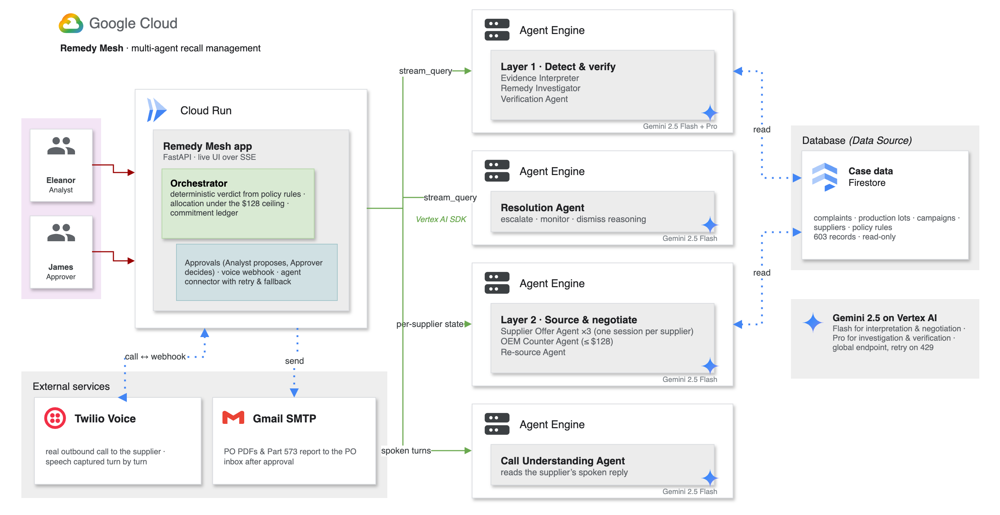

<div align="center">

# Remedy Mesh

### Catch recall scope drift from the evidence — then negotiate the fix, with a human approving every move.

*A multi-agent system built on Google ADK + Gemini (Vertex AI) for the Google AI Builder Cup 2026.*

**🔗 Live demo:** https://remedymesh-tl6pmvrlbq-uc.a.run.app
**Sign in:** Analyst `eleanor` / `analyst123` · Approver `james` / `approve123`

</div>

---

## The problem

A car recall is "closed" once the fix is in the market. Two things can still go wrong, and both are
usually discovered late, from field complaints rather than from analysis:

1. **The scope drifts.** Vehicles built outside the recall's production window carry the same
   defect. They were never in the recall, so their owners are never told.
2. **The fix fails.** The remedy that was applied does not hold, and "repaired" vehicles start
   failing again: a *fix-the-fix*.

Once either is spotted, the work is still manual and slow. Someone has to prove the new vehicles
are affected, find replacement parts across suppliers under a cost ceiling, and amend the federal
Part 573 recall filing. While parts are short, owners get "interim" letters that warn them of the
risk without a fix. More defective vehicles stay on the road in the meantime.

### This is happening now

| Case | What happened | Source |
|---|---|---|
| **BMW integrated brake system** (supplier: Continental, now Aumovio) | US recall 24V-104 began in February 2024 at 79,670 vehicles. It grew to about **278,000 US vehicles** (24V-104 now covers 266,716, plus 24V-739 at 11,579), and in September 2024 BMW recalled about **1.5 million vehicles worldwide**. In 2026, recall **26V-422** states: *"Vehicles previously repaired under recall 24V739 or 24V104 will need to have the new remedy completed."* The fix itself had to be redone. | NHTSA recalls [24V-104](https://api.nhtsa.gov/recalls/campaignNumber?campaignNumber=24V104), [24V-739](https://api.nhtsa.gov/recalls/campaignNumber?campaignNumber=24V739), [26V-422](https://api.nhtsa.gov/recalls/campaignNumber?campaignNumber=26V422); [S&P Global](https://www.spglobal.com/automotive-insights/en/blogs/2024/10/bmw-hits-the-brakes-with-vehicle-recall); [Manufacturing.net](https://www.manufacturing.net/operations/news/22920068/bmw-cuts-outlook-after-braking-system-recall-hits-15-million-cars) |
| **Parts shortages leave owners waiting** | For 24V-739, BMW mailed *interim* letters warning owners of the risk; *"second letters will be mailed once the parts are available."* | NHTSA recall [24V-739](https://api.nhtsa.gov/recalls/campaignNumber?campaignNumber=24V739) |
| **The cost is real** | On July 30, 2026, Aumovio agreed to pay BMW **€350 million** to settle the dispute over the defective brake system. | [Gleiss Lutz](https://www.gleisslutz.com/en/mandates-firm-news/gleiss-lutz-advises-aumovio-eur-350-million-settlement-and-billion-euro-technology-partnership-bmw); [Baker McKenzie](https://www.bakermckenzie.com/en/newsroom/2026/08/bmw) |
| **GM 6.2L L87 V8** | The remedy for recall 25V-274 was largely a change to thicker engine oil. NHTSA then received **499 complaints of engine failure after the remedy was completed**, and on August 20, 2026 it opened Engineering Analysis **EA26005** covering **997,743 vehicles**. (That is an investigation, not a new recall.) | [GM Authority](https://gmauthority.com/blog/2026/08/gm-6-2l-l87-engine-post-recall-failures-piling-up-nhtsa-investigation-shows/); [TruckDaily](https://truckdaily.com/nhtsa-ea26005-gm-62-l87/) |
| **Scope found after the fact** | In BMW's i4 frame recall 24V-611, BMW's own filing says the suspect part *"had been produced outside of the previously identified suspect production range"* and that *"the previously identified containment range needed to be expanded."* | BMW Part 573 report, [24V-611](https://static.nhtsa.gov/odi/rcl/2024/RCLRPT-24V611-6291.PDF) |

Two manufacturers, two years, the same pattern: a remedy shipped, then new complaints showed the
scope or the fix was not enough.

### What Remedy Mesh claims

- **Detect it from the evidence, early.** Re-check closed recalls against new complaints, production
  lots and remedy dates, and flag scope drift or a failing remedy with the exact rule that fired.
- **Never guess.** The verdict is deterministic policy. Gemini agents interpret, investigate and
  independently verify, and a missing record is chased rather than assumed.
- **Shorten the gap to a fix.** Once confirmed, source replacement parts from pre-qualified
  suppliers under a cost ceiling, confirm each one on a real phone call, and draft the Part 573
  amendment.
- **Keep humans in charge.** Every purchase order and filing is a draft until an Approver signs off.

Remedy Mesh's hero case is modelled on the BMW brake pattern above. Names, VINs and the OEM in the
app are fictional, and the case data is synthetic. The pattern is real.

## The idea

**Remedy Mesh watches closed recalls against live field evidence, proves when scope has drifted —
never guesses — and then does the two things a human would otherwise do by hand:**

1. **Procures the fix** — negotiates a multi-supplier split for the replacement parts, confirms each
   deal on a **real phone call**, and drafts the purchase orders.
2. **Amends the recall** — drafts the **NHTSA Part 573** recall-amendment memo that adds the
   newly-implicated vehicles to the campaign.

Both outputs are **drafts**. A human reviews and approves every one before anything is sent or
filed. That human-in-the-loop checkpoint is the whole point: the agents do the work, people keep
authority.

---

## How it works

```
  Field evidence (complaints · campaigns · production lots · policy)
                               │
      ┌─────────────────────────▼─────────────────────────┐
      │  LAYER 1 — Evidence Verification ("Remedy Watchdog")│
      │  Deterministic core (never guesses) + Gemini        │
      │  narration + a Resolution Loop that chases missing  │
      │  records. 7-way decision taxonomy.                  │
      └─────────────────────────┬─────────────────────────┘
                                │  scope expansion CONFIRMED?
                       ┌─────────┴─────────┐
                      NO                   YES ──► drafts the Part 573 amendment
                       │                    │
             Resolution Agent        ┌──────▼──────────────────────────────┐
             proposes the next       │  LAYER 2 — Negotiation Mesh           │
             action (monitor,        │  Each supplier negotiates in its OWN  │
             chase, flag…)           │  isolated Gemini session, in parallel │
                                     │  (sealed-bid). An OEM agent counters  │
                                     │  over-ceiling offers, then allocates. │
                                     │  Real Twilio calls confirm each deal. │
                                     └──────┬───────────────────────────────┘
                                            │
              Purchase Orders + Part 573 amendment  →  NOTIFICATIONS queue
                        (a human reviews, edits, approves / files)
                                            │
                              RESOLVED  +  full audit trail
```

Two human roles wrap the whole thing (a real **maker-checker** separation of duties):

- **Analyst** — investigates cases, runs the negotiation mesh, places the confirmation calls.
- **Approver** — reviews and sends purchase orders, files Part 573 amendments. Cannot do the
  Analyst's job, and vice-versa (enforced server-side). Once a case is run, the Approver sees an
  exact **replay** of the Analyst's run — nothing re-runs.

## Architecture on Google Cloud



- **Cloud Run** hosts the web app, the deterministic orchestrator (verdicts, allocation under the
  price ceiling, the commitment ledger), the approval workflow and the Twilio voice webhook.
- **Vertex AI Agent Engine** runs the **8 Google ADK agents**, each as its own managed service.
  Cloud Run calls them through the Vertex AI SDK (`stream_query`); the Supplier Offer Agent runs
  once per supplier in an isolated session.
- **Gemini 2.5 on Vertex AI**: Flash for interpretation and negotiation, Pro for investigation and
  verification.
- **Firestore** holds the case data the agents read (complaints, production lots, campaigns,
  suppliers, policy rules).

Detailed view, with every component and agent: [`docs/remedy-mesh-architecture-gcp.png`](docs/remedy-mesh-architecture-gcp.png).
Both diagrams are editable in draw.io (`docs/*.drawio`).

## What makes it distinctive

**The negotiation mesh.** The core agentic pattern — each supplier bargaining in an *isolated*
Gemini session, concurrently, converging into a single OEM decision — is rendered as a live
**mesh** in the UI: parallel supplier lanes showing *opening offer → OEM counter (with the model's
reasoning) → revised*, with connectors flowing into an OEM decision node. You *see* the session
isolation happen, you don't have to be told it.

**Deterministic core, LLM on top.** Every verdict and allocation is rule-based and reproducible;
the Gemini agents interpret, narrate and negotiate *within bounds*. If the model is unavailable,
the system still produces a correct, explained result. Trust is a feature, not an afterthought.

**It closes the real-world loop.** A confirmed defect produces **both** the supplier-side purchase
orders **and** the regulator-side Part 573 recall amendment — each through the same human approval.

## Key features

- Evidence verification with a 7-way decision taxonomy (confirmed / scope-drift / remedy-quality /
  monitor / … ) and a Resolution Loop that chases missing lot records.
- Live **negotiation mesh** across 3 suppliers against a private price ceiling and delivery deadline.
- **Real Twilio phone calls** — fully conversational (no IVR), understood live by Gemini.
- **Selective re-negotiation** — if a supplier declines on the call, only that commitment is
  re-sourced to a reserve supplier, which must *also* be confirmed by call before a PO is drafted.
- **Purchase-order PDFs** (with the call transcript as provenance) and **NHTSA Part 573** amendment
  memos — drafted, reviewed, approved/filed, and emailed for real.
- **Maker-checker** auth with deterministic replay.
- **Rate-limit resilience** — a transient Gemini limit degrades gracefully (the confirmed verdict
  and the Part 573 are preserved; the run is cleanly retry-able) instead of crashing.
- Light/dark UI, live SSE run feed, a Resolved queue and a full per-case audit trail.

## Tech stack

| | |
|---|---|
| **AI** | Google ADK (`LlmAgent` + FunctionTools), 8 agents on **Vertex AI Agent Engine**, Gemini 2.5 Flash + Pro on **Vertex AI** (ADC — no API key) |
| **Data** | Firestore (Native mode): the case data the agents read |
| **Backend** | Python, FastAPI, Uvicorn, ReportLab (PDFs), Server-Sent Events |
| **Telephony / email** | Twilio Programmable Voice · Gmail SMTP |
| **Frontend** | Vanilla HTML/CSS/JS single-page app (no build step) |
| **Deploy** | Google Cloud Run (SPA + API + orchestrator + webhook, one origin) · agents deployed separately on Agent Engine |

## Running it locally

```bash
# 1) Backend (from remedy_mesh_app/, with a virtualenv that has requirements.txt)
#    Vertex AI via Application Default Credentials:
export GOOGLE_GENAI_USE_VERTEXAI=TRUE
export GOOGLE_CLOUD_PROJECT=<your-gcp-project-id>
export GOOGLE_CLOUD_LOCATION=us-central1
gcloud auth application-default login
python -m uvicorn remedy_mesh.server:app --host 127.0.0.1 --port 8080

# 2) Frontend (from frontend/)
python -m http.server 5500          # → http://localhost:5500

# Optional, for real supplier calls: Twilio creds + a public webhook (ngrok or Cloud Run).
# Optional, for real PO/573 email: PO_SMTP_* env vars (Gmail app password).
```

Sign in as **eleanor / analyst123** (Analyst) or **james / approve123** (Approver), open
**CASE-001** (the confirmed hero case), and watch the mesh negotiate.

## Repository layout

```
remedy_mesh_app/            FastAPI backend + the agent pipeline
  remedy_mesh/
    logic.py                deterministic "never guesses" core + decision taxonomy
    layer1.py / layer2.py   evidence verification · negotiation mesh
    negotiation.py          allocation + commitment ledger + selective re-negotiation
    pipeline.py             the gate (Layer 1 → Layer 2) + graceful degradation
    resolution.py           ResolutionAgent (LLM interpretation of the verdict)
    voice.py / callunderstanding.py   Twilio calls + in-call Gemini understanding
    purchase_order.py / part573.py    PO + Part 573 PDF builders
    email_po.py / auth.py / server.py other services + the API/webhook
frontend/index.html         the single-page app (dashboard, case view, mesh, notifications)
remedy_mesh_synthetic_data/ the synthetic (but realistically-shaped) corpus
Dockerfile                  single-container Cloud Run build
REMEDY_MESH_OVERVIEW.md     full system overview · DESIGN_DECISIONS.md  design log
```

---

<div align="center">

*Evidence verification → scope-drift confirmation → multi-supplier negotiation → real calls →
purchase orders + Part 573 amendment → human approval → real send/file — under a maker-checker
split with a full audit trail.*

</div>
